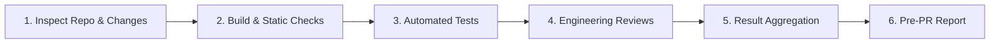

# Gate 1 Local Code Validation and Review Skill

## 1. Purpose & Activation

This skill validates local code modifications before a Pull Request (PR) is opened, providing developers and the Entry Guard Agent with immediate, actionable feedback on build integrity, test results, architectural health, security posture, performance, maintainability, and business logic correctness.

**Activate when:**
- A developer runs pre-PR local validation on their working branch or uncommitted changes.
- The Entry Guard Agent initiates a Gate 1 inspection on a local workspace or validation request.
- Review context requests pre-commit, pre-push, or pre-PR quality verification across any repository or technology stack.

## 2. Execution Modes

The skill operates identically across two execution environments using a single shared workflow:

| Execution Mode | Invocation Mechanism | Primary Target | Output Destination |
|---|---|---|---|
| **Mode A: Local Developer** | Local CLI / IDE command / hook | Working tree & uncommitted diffs | Local terminal / markdown report |
| **Mode B: Entry Guard Agent** | Agent platform orchestration | Workspace path & branch diff | Platform scorecard & review gate |

*Both modes enforce identical quality standards, scoring rules, and blocking criteria.*

## 3. Six-Stage Validation Workflow



1. **Repository & Change Inspection**: Detect repo root, active branch, multi-language stacks (Python, TypeScript, C#, Java, Go, SQL), and changed files (staged, unstaged, untracked).
2. **Build & Static Validation**: Execute native build commands and linters/typecheckers. Capture exit codes and compilation diagnostics.
3. **Automated Testing**: Discover and run unit/integration test runners (pytest, jest, dotnet test, mvn test). Record passed, failed, skipped, and unavailable counts.
4. **Engineering Review Dispatch**: Dispatch changed code to specialized engineering review skills:
   - [`skill-eng-security`](../skill-eng-security/SKILL.md): Injection, auth, secrets, OWASP (SEC01–SEC12).
   - [`skill-eng-performance`](../skill-eng-performance/SKILL.md): N+1 queries, async I/O, resource leaks (PERF01–PERF14).
   - [`skill-eng-maintainability`](../skill-eng-maintainability/SKILL.md): Complexity, duplication, readability (MAINT01–MAINT14).
   - [`skill-eng-modularity`](../skill-eng-modularity/SKILL.md): Layer boundaries, cyclic imports, god classes (MOD01–MOD12).
   - [`skill-eng-business-logic`](../skill-eng-business-logic/SKILL.md): Spec alignment, calculations, states (BIZ01–BIZ10).
5. **Result Aggregation**: Aggregate dimension scores (0.0–10.0 scale), deduplicate overlapping root causes, and evaluate blocking conditions.
6. **Pre-PR Validation Report**: Produce a structured Markdown and JSON report with a clear PR readiness verdict (`PASS`, `BLOCKED`, or `INCOMPLETE`).

*Detailed stage execution instructions are in [`references/validation-workflow.md`](references/validation-workflow.md).*

## 4. Scoring, Blocking & Readiness Rubric

Gate 1 enforces a unified 0.0–10.0 dimension score and three global statuses:

| Status | Condition | PR Readiness Verdict |
|---|---|---|
| **`PASS`** | All required builds and tests pass, all dimensions $\ge 9.0$, zero critical findings, $\le 1$ minor issue. |  **Ready for PR Creation.** |
| **`BLOCKED`** | Any build failure, test failure, dimension $< 9.0$, or confirmed critical violation. | 🔴 **Blocked.** Must remediate issues before opening PR. |
| **`INCOMPLETE`** | Required build/test tools or sub-agents failed to execute, and no blocking failure occurred. | ⚠️ **Incomplete.** Resolve missing tools or re-run validation. |

*If both a blocking issue and an incomplete check occur, the overall verdict is `BLOCKED` with the incomplete check noted.*

## 5. Safety & Non-Destructive Principles

- **Zero Source Mutation**: Gate 1 is strictly an inspection and reporting tool. It never automatically modifies, formats, or refactors source files.
- **No Automatic Remote Actions**: Never automatically executes `git push`, commits changes, or creates remote PRs.
- **Safe Command Execution**: Only invokes safe, non-destructive discovery, build, and test commands from repository configuration.

## 6. Output Contract

Gate 1 outputs structured JSON adhering to the Scorecard Aggregator contract and a developer-readable Markdown summary:

```json
{
  "gate": "GATE_1_LOCAL",
  "status": "PASS",
  "ready_for_pr": true,
  "repository": { "root": ".", "branch": "feature/tax-calc", "stacks": ["Python", "TypeScript"] },
  "build_and_static": { "status": "passed", "errors": [] },
  "automated_tests": { "status": "passed", "total": 42, "passed": 42, "failed": 0, "skipped": 0 },
  "dimensions": {
    "security": { "score": 10.0, "blocked": false, "findings": [] },
    "performance": { "score": 10.0, "blocked": false, "findings": [] },
    "maintainability": { "score": 9.0, "blocked": false, "findings": [{ "ruleId": "MAINT03", "severity": "low", "title": "Ambiguous variable name" }] },
    "modularity": { "score": 10.0, "blocked": false, "findings": [] },
    "business_logic": { "score": 10.0, "blocked": false, "findings": [] }
  },
  "blocking_reasons": [],
  "uncertainty_notes": []
}
```

*Full JSON schema and Markdown report layout are defined in [`references/report-schema.md`](references/report-schema.md).*

## 7. Supporting References

- **Validation Workflow**: [`references/validation-workflow.md`](references/validation-workflow.md) — Step-by-step 6-stage execution instructions and stack detection.
- **Report Schema**: [`references/report-schema.md`](references/report-schema.md) — Comprehensive JSON contract, Markdown layouts, and status enums.
- **Validation Test Suite**: [`validation/test-suite.json`](validation/test-suite.json) — Automated test scenarios covering all 14 Gate 1 requirements.

