# LangGraph Agent Orchestration

## 1. Purpose & Activation

This skill provides technical domain knowledge for architecting, coordinating, implementing, reviewing, and testing single-agent and multi-agent systems using LangGraph in Python.

**Activate when tasks involve:**
- Architecting or reviewing single-agent, sequential, parallel, conditional, or supervisor-based multi-agent workflows.
- Enforcing Clean Architecture graph package shapes (`agents/graphs/[feature]/`) and dependency boundaries.
- Bridging LangGraph tools to the Application layer (`application/features/`) without bypassing business logic.
- Abstracting LLM model clients behind provider factories (`agents/llm/`) and centralizing configuration.
- Enforcing orchestration guardrails: recursion limits, execution timeouts, token budgets, and handoff contracts.
- Handling partial failures, branch error aggregation, and evidence traceability in final responses.
- Writing deterministic orchestration unit and integration tests using test doubles and mocked handlers.

**Do NOT activate solely because:**
- A project uses Python or simple scripts without agent orchestration.
- The task focuses strictly on low-level graph compilation, state reducers, or edge topology (delegate to `langgraph-graph-construction`).
- The task is strictly about database checkpointing, tool sandboxing, human approval interrupts, or streaming protocols.

---

## 2. Scope & Skill Boundaries

```mermaid
flowchart LR
    subgraph InScope [" LangGraph Agent Orchestration (This Skill)"]
        Arch["Graph Package Architecture & Dependency Rules"]
        Topologies["Agent Topologies: Sequential / Parallel / Supervisor"]
        ToolBridge["Tool-to-Application Layer Bridging"]
        ModelAbs["Model Provider Abstraction & Config"]
        Guardrails["Orchestration Guardrails & Test Doubles"]
    end

    subgraph Boundaries [" Delegated Responsibilities"]
        GraphConst["Graph Construction -> State Schemas, Reducers & Graph Compilation"]
        Eng["Engineering Skills -> Finding Classification, Severity, 0-10 Scores & Merge Blocking"]
        Persist["Persistence -> Checkpointer Storage Engines"]
        Tools["Tools Runtime -> Execution Sandboxes"]
        HITL["Human-in-the-Loop -> Interrupt Mechanics"]
    end

    InScope -.-> Boundaries
```

---

## 3. Orchestration Rules & Checklist

| ID | Rule Name | Objective |
|---|---|---|
| `ORCH01` | Canonical Package Layout | Ensure graph packages follow clean separation of concerns and layered folder conventions. |
| `ORCH02` | Seam Service Isolation | Ensure entry points invoke graphs through dedicated seam services, not raw graph instances. |
| `ORCH03` | Dependency Boundary Rules | Enforce strict inward dependency directions; forbid domain/application from importing `agents/`. |
| `ORCH04` | Tool-to-Application Bridging | Ensure tools act as thin adapters delegating to Application handlers; forbid direct DB/infra access. |
| `ORCH05` | Model Provider Abstraction | Abstract LLM clients behind provider factories or `BaseChatModel` interfaces with safe secrets. |
| `ORCH06` | Orchestration Guardrails | Enforce runtime guardrails: `recursion_limit`, timeout envelopes, token counters, and concurrency bounds. |
| `ORCH07` | Topology Proportionality | Use explicit edges for deterministic flows; reserve LLM supervisor routers for dynamic routing. |
| `ORCH08` | Handoff Contract Validation | Validate cross-agent state transfers and inter-agent handoff payloads with explicit schemas. |
| `ORCH09` | Partial Failure Aggregation | Handle branch errors gracefully in fan-out/fan-in topologies without losing failure traceability. |
| `ORCH10` | Deterministic Testing | Test agent graph orchestration deterministically using test doubles (`FakeListChatModel`). |

*Detailed criteria, evidence patterns, and remediation per rule are defined in [`references/checklist.md`](references/checklist.md).*

---

## 4. Architectural Rules & False-Positive Safeguards

When designing, implementing, or reviewing agent orchestration, follow these guidelines:

- **Specification-Driven:** Treat the supplied feature specification as the source of truth. Do not invent business requirements or tool capabilities.
- **Dependency Boundary Rules:** Enforce directional dependency rules. In external repositories, assess equivalent separation of concerns without forcing exact folder names.
- **Supervisor vs. Fixed Topologies:** Choose the simplest topology that satisfies the specification. Use explicit edges for deterministic flows.
- **Tools as Thin Adapters:** Tools must delegate business operations to Application-layer handlers and never execute direct DB sessions.
- **Guardrails Are Enforced Mechanisms:** Ensure configured recursion limits and timeouts are actively passed to graph execution.
- **Evidence-Based Review:** Report confirmed defects with concrete file and line evidence. Record uncertainty when evidence is insufficient.

---

## 5. Engineering Skill Integration

This skill supplies orchestration domain expertise and delegates finding classification, scoring, and blocking to standard Engineering Skills:
1. **Identify Architectural/Orchestration Defect**: Pinpoint the concrete defect with line and file evidence.
2. **Map to Applicable Engineering Dimension**:
   - **Modularity** ([`skill-eng-modularity`](../../engineering/skill-eng-modularity/SKILL.md)): Layer separation violations, tool-to-infrastructure leakage.
   - **Maintainability** ([`skill-eng-maintainability`](../../engineering/skill-eng-maintainability/SKILL.md)): Untyped handoffs, hardcoded provider configurations.
   - **Performance** ([`skill-eng-performance`](../../engineering/skill-eng-performance/SKILL.md)): Missing `recursion_limit`, missing execution timeouts.
   - **Security** ([`skill-eng-security`](../../engineering/skill-eng-security/SKILL.md)): Hardcoded API keys, unvalidated tool inputs.
   - **Business Logic** ([`skill-eng-business-logic`](../../engineering/skill-eng-business-logic/SKILL.md)): Fabricated tool outputs, lost branch aggregation.
3. **Delegate Scoring**: Use the platform's native 0–10 scale and Gate policies; never invent local scoring.

---

## 6. Supporting References

- **Inspection Checklist**: [`references/checklist.md`](references/checklist.md) — Detailed criteria, code patterns, detection, and remediation per rule.
- **Architecture & Patterns**: [`references/architecture-and-patterns.md`](references/architecture-and-patterns.md) — Canonical graph package structure, topologies, and tool bridging.
- **Validation Suite**: [`validation/test-suite.json`](validation/test-suite.json) — Automated test cases for detection and false-positive verification.
