# LangGraph Agent Orchestration

## 1. Purpose & Activation

This skill provides technical domain knowledge for architecting, coordinating, implementing, reviewing, and testing single-agent and multi-agent systems using LangGraph in Python.

**Activate when tasks involve:**
- Architecting or reviewing single-agent, sequential, parallel, conditional, or supervisor-based multi-agent workflows.
- Enforcing Clean Architecture graph package shapes (`agents/graphs/[feature]/`) and dependency boundaries.
- Bridging LangGraph tools to the Application layer (`application/features/`) without bypassing business logic or handlers.
- Abstracting LLM model clients behind provider factories (`agents/llm/`) and centralizing configuration.
- Enforcing orchestration guardrails: recursion limits, execution timeouts, token budgets, and handoff contracts.
- Handling partial failures, branch error aggregation, and evidence traceability in final responses.
- Writing deterministic orchestration unit and integration tests using test doubles and mocked handlers.

**Do NOT activate solely because:**
- A project uses Python or simple scripts without agent orchestration.
- The task focuses strictly on low-level graph compilation, state reducers, or edge topology (delegate to `langgraph-graph-construction`).
- The task is strictly about database checkpointing, tool sandboxing, human approval interrupts, or streaming protocols.

---

## 2. Scope & Skill Boundaries

```mermaid
flowchart LR
    subgraph InScope [" LangGraph Agent Orchestration (This Skill)"]
        Arch["Graph Package Architecture & Dependency Rules"]
        Topologies["Agent Topologies: Sequential / Parallel / Supervisor"]
        ToolBridge["Tool-to-Application Layer Bridging"]
        ModelAbs["Model Provider Abstraction & Config"]
        Guardrails["Orchestration Guardrails & Test Doubles"]
    end

    subgraph Boundaries [" Delegated Responsibilities"]
        GraphConst["Graph Construction -> State Schemas, Reducers & Graph Compilation"]
        Eng["Engineering Skills -> Finding Classification, Severity, 0-10 Scores & Merge Blocking"]
        Persist["Persistence -> Checkpointer Storage Engines"]
        Tools["Tools Runtime -> Execution Sandboxes"]
        HITL["Human-in-the-Loop -> Interrupt Mechanics"]
        Stream["Streaming -> SSE/gRPC Stream Wire Protocols"]
    end

    InScope -.-> Boundaries
```

---

## 3. Reference Map

| Sub-Task | Reference Document | Focus Areas |
|---|---|---|
| **Package Architecture** | [`references/graph-package-architecture.md`](references/graph-package-architecture.md) | Canonical `agents/` layout, seam service (`agents/services/`), dependency boundary rules, naming rules, structural invariants. |
| **Topologies & Coordination** | [`references/agent-topologies-and-coordination.md`](references/agent-topologies-and-coordination.md) | Single-agent, sequential, parallel (fan-out/fan-in), conditional, supervisor delegation, handoffs, failure handling. |
| **Tool-to-App Bridging** | [`references/application-layer-tool-bridging.md`](references/application-layer-tool-bridging.md) | Thin tool adapters, handler DI reuse, forbidding direct DB/infrastructure access, missing capability gaps. |
| **Model Abstraction** | [`references/model-provider-abstraction.md`](references/model-provider-abstraction.md) | `BaseChatModel` interfaces, provider factory (`infrastructure/` vs `agents/llm/`), secrets safety, test doubles (`FakeListChatModel`). |
| **Testing & Guardrails** | [`references/orchestration-testing-and-guardrails.md`](references/orchestration-testing-and-guardrails.md) | `recursion_limit`, timeout envelopes, token counters, handoff validation, partial failure aggregation, evidence integrity. |

---

## 4. Architectural Rules & False-Positive Safeguards

When designing, implementing, or reviewing agent orchestration, follow these guidelines:

- **Specification-Driven:** Treat the supplied feature specification and established project contracts as the source of truth for required behavior. Do not invent business requirements, tool capabilities, or fallback behavior. If requirements conflict or are incomplete, document the gap.
- **Dependency Boundary Rules:** In repositories that adopt the canonical Clean Architecture graph layout, enforce directional dependency rules and associated structural invariants. In external repositories, assess equivalent dependency boundaries and separation of concerns without forcing canonical folder names or package structures.
- **Supervisor vs. Fixed Topologies:** Choose the simplest topology that satisfies the specification. Use explicit edges for deterministic sequential flows, parallel fan-out/fan-in where work is independent, and conditional routing where decisions are required. Add a supervisor or LLM-based router only when its dynamic decision-making capability is needed.
- **Tools as Thin Adapters:** Tools should delegate business operations to existing Application-layer handlers. They must not bypass those handlers through direct database sessions, infrastructure access, or duplicated business logic. If a required capability has no suitable handler, report an Application capability gap.
- **Typed Contracts:** Validate external inputs and meaningful inter-agent handoff payloads against explicit contracts. Follow the project's state schema and reducer conventions for ordinary graph-state updates; do not require a separate Pydantic model for every state update or edge.
- **Guardrails Are Enforced Mechanisms:** Comments and docstrings do not establish enforcement. Verify that configured recursion limits, timeouts, budget controls, concurrency bounds, and retry limits are applied to the actual execution path.
- **Failure and Aggregation Semantics:** Distinguish recoverable failures, terminal failures, and partial results. Retries must be bounded and appropriate for the operation. Aggregation must validate branch results and preserve failure information required by the specification.
- **Evidence and False Positives:** Report confirmed defects with concrete file and line evidence. Do not infer a violation solely from naming, directory structure in an external repository, or the absence of a preferred implementation pattern. Record uncertainty when the evidence is insufficient.
- **Consolidate Root Causes:** Report symptoms of the same underlying defect as one finding when they share a root cause and remediation. Keep independently actionable defects separate.
- **Version and Project Compatibility:** Inspect declared and installed LangGraph versions, relevant dependency constraints, and existing project conventions before recommending APIs or code changes. Do not assume that examples from another version are directly compatible.

---

## 5. Engineering Skill Integration

This skill supplies orchestration domain expertise and delegates finding classification, scoring, and blocking to standard Engineering Skills:
1. **Identify Architectural/Orchestration Defect**: Pinpoint the concrete defect with line and file evidence.
2. **Map to Applicable Engineering Dimension**:
   - **Modularity** ([`skill-eng-modularity`](../../engineering/skill-eng-modularity/SKILL.md)): Layer separation violations, tool-to-infrastructure leakage, bypassed application layer, circular graph dependencies.
   - **Maintainability** ([`skill-eng-maintainability`](../../engineering/skill-eng-maintainability/SKILL.md)): Untyped handoffs, hardcoded provider configurations, tangled supervisor logic.
   - **Performance** ([`skill-eng-performance`](../../engineering/skill-eng-performance/SKILL.md)): Missing `recursion_limit`, missing execution timeouts, serial execution of independent agent tasks.
   - **Security** ([`skill-eng-security`](../../engineering/skill-eng-security/SKILL.md)): Hardcoded API keys, state leaking unvetted user payloads, unvalidated tool inputs.
   - **Business Logic** ([`skill-eng-business-logic`](../../engineering/skill-eng-business-logic/SKILL.md)): Fabricated tool outputs, lost branch aggregation, supervisor routing contradicting specification.
3. **Delegate Scoring**: Use the platform's native 0–10 scale and Gate policies; never invent local scoring.
