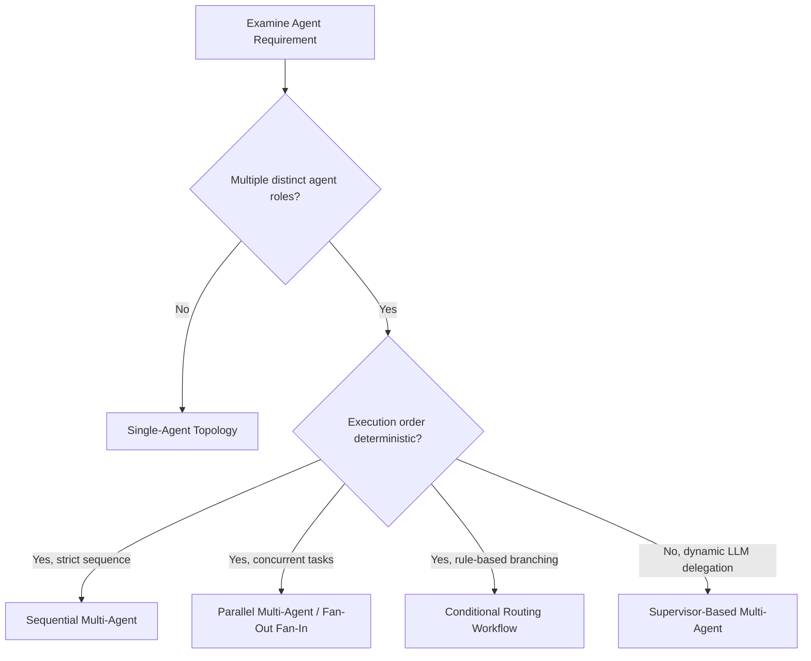

# Agent Topologies & Multi-Agent Coordination

This reference documents the selection, design, contracts, handoffs, and failure policies for agent orchestration topologies in LangGraph.

---

## 1. Topology Selection Guide

Translate feature specifications directly into the simplest topology that satisfies the functional requirement:



| Topology | Best Suited For | Key Trade-Offs |
|---|---|---|
| **Single-Agent** | Focused reasoning task with specific tools (e.g. SQL generator, document summarizer). | Simple, fast; does not scale to conflicting multi-persona responsibilities. |
| **Sequential** | Pipeline stages where step B strictly depends on step A (e.g. Ingest -> Validate -> Transform). | Predictable and deterministic; latency is cumulative across steps. |
| **Parallel (Fan-Out/Fan-In)** | Independent evaluations running concurrently (e.g. multi-expert review, parallel tool querying). | Low latency; requires explicit state reducers and resilient partial-failure aggregation. |
| **Conditional** | Rule-driven routing where path is determined by deterministic state conditions or classification. | Fast and explainable; rules must have comprehensive fallback routes. |
| **Supervisor-Based** | Dynamic multi-turn tasks where an orchestrator agent delegates to specialist workers and decides when goal is met. | High flexibility; higher token cost, non-deterministic routing, risk of infinite delegation loops if unbounded. |

---

## 2. Topology Patterns & Implementation

### A. Single-Agent Topology
Single-agent workflows maintain the full graph package structure (`state.py`, `nodes/agent.py`, `edges.py`, `graph.py`):

```python
# agents/graphs/summarizer/graph.py
from langgraph.graph import StateGraph, START, END
from agents.graphs.summarizer.state import SummarizerState
from agents.graphs.summarizer.nodes.summarize import summarize_node

builder = StateGraph(SummarizerState)
builder.add_node("summarize", summarize_node)
builder.add_edge(START, "summarize")
builder.add_edge("summarize", END)
graph = builder.compile()
```

### B. Sequential Multi-Agent Topology
Passes typed payloads sequentially across nodes:

```python
# agents/graphs/data_pipeline/graph.py
builder = StateGraph(PipelineState)
builder.add_node("extract", extract_node)
builder.add_node("transform", transform_node)
builder.add_node("load", load_node)

builder.add_edge(START, "extract")
builder.add_edge("extract", "transform")
builder.add_edge("transform", "load")
builder.add_edge("load", END)
```

### C. Parallel Multi-Agent Topology (Fan-Out / Fan-In)
Executes concurrent specialist nodes and merges results using Annotated reducers:

```python
# agents/graphs/multi_review/state.py
import operator
from typing import Annotated, TypedDict, List

class ReviewState(TypedDict):
    pr_id: str
    diff_text: str
    reviews: Annotated[List[dict], operator.add]  # Reducer accumulates concurrent branch outputs

# agents/graphs/multi_review/graph.py
builder = StateGraph(ReviewState)
builder.add_node("security_reviewer", security_node)
builder.add_node("performance_reviewer", performance_node)
builder.add_node("aggregator", aggregate_node)

# Fan-out from START
builder.add_edge(START, "security_reviewer")
builder.add_edge(START, "performance_reviewer")

# Fan-in to aggregator
builder.add_edge("security_reviewer", "aggregator")
builder.add_edge("performance_reviewer", "aggregator")
builder.add_edge("aggregator", END)
```

### D. Supervisor-Based Dynamic Coordination
A supervisor node inspects current state, selects the next specialist agent, and terminates when objectives are met:

```python
# agents/graphs/triage/nodes/supervisor.py
from pydantic import BaseModel, Field
from typing import Literal

class RouterDecision(BaseModel):
    next_agent: Literal["code_agent", "db_agent", "FINISH"]
    instructions: str = Field(description="Context and task for delegate")

async def supervisor_node(state: TriageState, llm: BaseChatModel) -> dict:
    structured_llm = llm.with_structured_output(RouterDecision)
    decision = await structured_llm.ainvoke(build_supervisor_prompt(state))
    return {
        "next_step": decision.next_agent,
        "iteration_count": state.get("iteration_count", 0) + 1,
        "messages": [f"Supervisor delegated to {decision.next_agent}"]
    }

# agents/graphs/triage/edges.py
def route_supervisor(state: TriageState) -> str:
    # Explicit loop bound guardrail
    if state.get("iteration_count", 0) >= 5 or state.get("next_step") == "FINISH":
        return "FINISH"
    return state.get("next_step", "FINISH")
```

---

## 3. Handoff Contracts & Payload Validation

1. **Typed State Channels**: Use Pydantic models or `TypedDict` to validate handoff payloads between nodes. Avoid untyped unstructured dictionary blobs (`state["data"]`).
2. **Lean State Delivery**: Nodes must read only the state keys necessary for their execution and return only partial dictionary updates.
3. **No Hidden State Channels**: Never pass data through global variables, node module attributes, or side channels outside of graph state.

---

## 4. Partial Failures & Branch Aggregation

In parallel and multi-agent topologies:
- **Resilient Node Wrappers**: Each node must handle its own domain exceptions and write typed error representations (e.g. `{"status": "error", "error_message": "..."}`) into state rather than terminating the entire graph unhandled.
- **Aggregation Policy**: Aggregator nodes must inspect each branch result, handle missing or errored branches gracefully, and synthesize partial findings rather than dropping results or raising unhandled `KeyError` exceptions.

