# LangGraph Graph Construction

## 1. Purpose & Activation

This skill provides technical domain knowledge for defining, assembling, compiling, and testing LangGraph state graphs in Python applications.

**Activate when tasks involve:**
- Designing or reviewing LangGraph state schemas using `TypedDict`, `BaseModel`, or dataclasses.
- Implementing pure, associative reducers with `Annotated[T, reducer]` (e.g. `add_messages`, `operator.add`).
- Adding nodes, static edges, and conditional routing functions with explicit path maps.
- Dynamically altering graph control flow using `Command(goto=...)` and state updates.
- Validating graph compilation (`builder.compile()`), reachability from `START`, and termination at `END`.
- Encapsulating modular subgraphs with explicit input/output boundaries.
- Writing deterministic unit tests for nodes, reducers, and graph connectivity.

**Do NOT activate solely because:**
- The task is about multi-agent supervisor orchestration or Clean Architecture folder structures (delegate to `langgraph-agent-orchestration`).
- The task is strictly about database checkpoint storage engines (delegate to `langgraph-state-and-persistence`).
- The task is strictly about tool definitions or runtime sandboxing (delegate to `langgraph-tools-and-runtime`).
- The task is strictly about human approval pauses or interrupts (delegate to `langgraph-human-in-the-loop`).

---

## 2. Scope & Skill Boundaries

```mermaid
flowchart LR
    subgraph InScope [" LangGraph Graph Construction (This Skill)"]
        State["State Schemas & Reducer Mechanics"]
        NodesEdges["Nodes, Static Edges & Conditional Routing"]
        CommandCtrl["Dynamic Control Flow (Command API)"]
        Compile["Graph Compilation & Topology Validation"]
        Subgraphs["Subgraph Encapsulation"]
    end

    subgraph Boundaries [" Delegated Responsibilities"]
        Orch["Agent Orchestration -> Multi-Agent Topologies & Folder Structure"]
        Persist["State & Persistence -> Database Checkpointers & Thread Recovery"]
        Tools["Tools & Runtime -> ToolNode Execution & Sandboxing"]
        HITL["Human-in-the-Loop -> Interrupt & Resume Flows"]
        Eng["Engineering Skills -> Finding Classification & 0-10 Scores"]
    end

    InScope -.-> Boundaries
```

---

## 3. Graph Construction Rules & Checklist

| ID | Rule Name | Objective |
|---|---|---|
| `GRAPH01` | Explicit State Schema Definition | Define graph state with explicit `TypedDict` or `BaseModel` annotations; forbid untyped `dict`. |
| `GRAPH02` | Pure and Associative Reducers | Use pure reducer functions (`operator.add`) without in-place list/dict mutations. |
| `GRAPH03` | Graph Topology Completeness | Ensure every node is reachable from `START` and has at least one valid path reaching `END`. |
| `GRAPH04` | Exhaustive Conditional Routing | Ensure conditional edge functions cover all possible return branches with explicit path maps. |
| `GRAPH05` | Dynamic Branching via `Command` | Ensure `Command(goto=...)` references declared graph node names or `END`. |
| `GRAPH06` | Safe Graph Compilation | Compile state graphs explicitly (`builder.compile()`) and validate graph structure before deployment. |
| `GRAPH07` | Parallel Execution Safety | Ensure parallel branches write to disjoint state keys or fields managed by associative reducers. |
| `GRAPH08` | State Immutability in Nodes | Return dictionary state diffs from node functions; never mutate input `state` in-place. |
| `GRAPH09` | Subgraph Boundary Encapsulation | Encapsulate subgraphs with explicit input/output schemas; avoid leaky state dependencies. |
| `GRAPH10` | Deterministic Unit Testing | Test individual nodes and full graph topologies in unit tests without live external services. |

*Detailed criteria, evidence patterns, and remediation per rule are defined in [`references/checklist.md`](references/checklist.md).*

---

## 4. Architectural Rules & False-Positive Safeguards

When designing, implementing, or reviewing LangGraph graph construction, follow these guidelines:

- **State Immutability:** Nodes must return partial update dictionaries. Reducers must not mutate existing state objects.
- **Topology Verification:** Verify that `START` leads to an initial node and all non-looping execution paths terminate at `END`.
- **Exhaustive Routing:** Conditional edge functions must map every conceivable outcome string to a declared target node.
- **Evidence-Based Review:** Base findings on concrete code inspections and verifiable graph compilation errors.
- **Version Compatibility:** Respect LangGraph v0.2+ conventions (e.g., `START`/`END` imports, `Command` object usage).

---

## 5. Engineering Skill Integration

This skill supplies graph construction domain expertise and delegates finding classification, scoring, and blocking to standard Engineering Skills:
1. **Identify Graph Defect**: Pinpoint the concrete defect with line and file evidence.
2. **Map to Applicable Engineering Dimension**:
   - **Maintainability** ([`skill-eng-maintainability`](../../engineering/skill-eng-maintainability/SKILL.md)): Untyped state schemas, missing path maps.
   - **Modularity** ([`skill-eng-modularity`](../../engineering/skill-eng-modularity/SKILL.md)): Leaky subgraph boundaries, monolithic node functions.
   - **Performance** ([`skill-eng-performance`](../../engineering/skill-eng-performance/SKILL.md)): In-place accumulator bloat, unindexed large state updates.
   - **Security** ([`skill-eng-security`](../../engineering/skill-eng-security/SKILL.md)): Unvalidated input schemas injected into control routing.
   - **Business Logic** ([`skill-eng-business-logic`](../../engineering/skill-eng-business-logic/SKILL.md)): Unreachable end states, incorrect conditional branches.
3. **Delegate Scoring**: Use the platform's native 0–10 scale and Gate policies.

---

## 6. Supporting References

- **Inspection Checklist**: [`references/checklist.md`](references/checklist.md) — Detailed criteria, code patterns, detection, and remediation per rule.
- **Architecture & Patterns**: [`references/architecture-and-patterns.md`](references/architecture-and-patterns.md) — State schemas, pure reducers, node/edge routing, and compilation.
- **Validation Suite**: [`validation/test-suite.json`](validation/test-suite.json) — Automated test cases for detection and false-positive verification.
