# LangGraph Graph Construction

## 1. Purpose & Activation

This skill provides technical domain knowledge for building, reviewing, modifying, and testing LangGraph graph definitions in Python across the Code Review Portal and external repositories.

**Activate when tasks involve:**
- `StateGraph` instantiation, configuration, compilation, and package exports.
- Defining state schemas using `TypedDict`, `dataclass`, or Pydantic `BaseModel`.
- Configuring state channels, partial state update contracts, and reducers (`Annotated`, `add_messages`, `operator.add`).
- Registering node functions and validating node input/output signatures.
- Adding normal edges, conditional edges, route functions, and destination path maps.
- Setting graph entry points (`START` or `set_entry_point`) and finish points (`END` or `set_finish_point`).
- Validating graph connectivity, reachability, branch convergence (fan-out/fan-in), and loop termination.
- Diagnosing graph construction/compilation errors versus runtime invocation failures.
- Writing deterministic unit and integration tests for graph topology and state transitions.

**Do NOT activate solely because:**
- A file contains the word "graph" in unrelated contexts (e.g. math plots, database graphs).
- The task focuses on supervisor multi-agent policies (orchestration), checkpoint persistence (persistence), tool execution (tools/runtime), streaming, or human approvals (HITL).

---

## 2. Scope & Skill Boundaries

```mermaid
flowchart LR
    subgraph InScope [" LangGraph Graph Construction (This Skill)"]
        State["State Schemas & Reducers"]
        Nodes["Node Registration"]
        Edges["Normal & Conditional Edges"]
        Compile["Graph Compilation & Topology"]
        Tests["Deterministic Graph Tests"]
    end

    subgraph Boundaries [" Delegated Responsibilities"]
        Eng["Engineering Skills -> Classification, Severity, Deductions & Merge Blocking"]
        Orch["Agent Orchestration -> Supervisor Topologies & Delegation Policies"]
        Persist["Persistence -> Checkpointers, Thread IDs & State Storage"]
        Tools["Tools & Runtime -> Tool Execution Context & Sandboxing"]
        HITL["Human-in-the-Loop -> Interrupts & Human Approval Workflows"]
        Stream["Streaming & Recovery -> Stream Events & Fault Recovery"]
    end

    InScope -.-> Boundaries
```

---

## 3. Version Detection & Technology Independence

Before reviewing or making graph modifications:

1. **Verify LangGraph Version**: Inspect `pyproject.toml`, `poetry.lock`, `Pipfile.lock`, `requirements.txt`, or run environment checks (`importlib.metadata.version("langgraph")`).
   - Check actual imported symbols and APIs used in the codebase (`START`, `END`, `MessagesState`, `add_messages`, `set_entry_point`).
   - Recommend and use APIs strictly compatible with the verified version.
   - Do not rely solely on generic labels (`0.2+`, `1.x`, `legacy`). If the version cannot be verified from dependencies or imports, explicitly state the uncertainty and avoid ungrounded version assertions.
   - Never update or alter repository dependencies as part of a review task.
2. **Preserve Repository Conventions**: Treat modular layouts (`state.py`, `nodes/`, `edges.py`, `graph.py`) as repository patterns, not universal LangGraph mandates. Support single-file graphs or alternative valid project structures without false positives.

---

## 4. Reference Map

| Sub-Task | Reference Document | Focus Areas |
|---|---|---|
| **State & Reducers** | [`references/state-schemas-and-reducers.md`](references/state-schemas-and-reducers.md) | `TypedDict`/Pydantic schemas, partial updates, `Annotated` reducers, intentional replacements vs concurrent merge conflicts. |
| **Nodes & Routing** | [`references/nodes-edges-and-routing.md`](references/nodes-edges-and-routing.md) | Node contracts, `add_node`, linear edges, conditional edges, path maps, bounded cycles vs nonterminating loops. |
| **Compilation & Topology** | [`references/graph-compilation-and-connectivity.md`](references/graph-compilation-and-connectivity.md) | `builder.compile()`, connectivity, reachability, export surfaces, compile vs runtime invocation error distinction. |
| **Testing & Verification** | [`references/graph-testing-and-validation.md`](references/graph-testing-and-validation.md) | Topology unit tests, mock state transitions, branch coverage, loop termination boundaries, deterministic fake nodes. |

---

## 5. False-Positive Safeguards & Review Rules

When reviewing LangGraph code, adhere to these strict verification rules:
- **Cycles vs Infinite Loops**: A cycle is NOT automatically a defect. Bounded cycles with exit conditions or loop counters are standard iterative patterns.
- **Explicit Edges vs Conditional Routes**: A node lacking a direct `add_edge` is NOT a defect if a conditional route or dynamic router directs flow to or from it.
- **Reducers vs Replacements**: A state field without a reducer is NOT automatically a bug; full-value overwrite/replacement is often the intended behavior for scalar fields.
- **Unreachable Nodes**: Verify reachability against all conditional route path maps and dynamic dispatchers before claiming a node is orphaned.
- **Package Layout**: An unconventional or flat file structure is NOT a defect if the graph compiles and functions cleanly.
- **Insufficient Evidence**: If code context is incomplete (e.g. external helper), record the uncertainty in `uncertainty_notes` rather than inventing a confirmed defect.

---

## 6. Engineering Skill Integration

This skill provides LangGraph domain expertise and delegates scoring, deductions, and merge blocking to the platform's Engineering Skills:
1. **Identify Technical Problem**: Pinpoint the concrete LangGraph defect with exact file and line references.
2. **Explain Concrete Impact**: State the operational consequence (e.g. compile failure, `InvalidUpdateError`, infinite loop).
3. **Map to Engineering Dimension**:
   - **Modularity** ([`skill-eng-modularity`](../engineering/skill-eng-modularity/SKILL.md)): Layer separation, package layout, monolithic nodes, cyclic imports.
   - **Maintainability** ([`skill-eng-maintainability`](../engineering/skill-eng-maintainability/SKILL.md)): Cryptic node names, untyped state dictionaries, tangled routing logic.
   - **Performance** ([`skill-eng-performance`](../engineering/skill-eng-performance/SKILL.md)): Unbounded loops, redundant state copies, synchronous blocking operations in nodes.
   - **Security** ([`skill-eng-security`](../engineering/skill-eng-security/SKILL.md)): Unsanitized user inputs across state channels, hardcoded secrets.
   - **Business Logic** ([`skill-eng-business-logic`](../engineering/skill-eng-business-logic/SKILL.md)): Flawed routing rules, missing state update invariants.
4. **Consolidate Root Causes**: Report multiple symptoms of the same root defect as a single primary finding.
