# LangGraph Human-in-the-Loop (HITL)

## 1. Purpose & Activation

This skill provides technical domain knowledge for architecting, validating, reviewing, and testing Human-in-the-Loop (HITL) workflows in LangGraph Python applications.

**Activate when tasks involve:**
- Introducing human approval, rejection, or review gates into a LangGraph workflow (`interrupt()`, `Command(resume=...)`).
- Handling graph pause and resumption with thread and checkpoint state.
- Processing reviewer decisions: approve, reject, request changes, or supply edited inputs.
- Validating and sanitizing human-provided resume values before continuing graph execution.
- Managing checkpoint-backed paused executions, thread ownership, and multi-tenant authorization.
- Securing approval boundaries: preventing replay attacks, duplicate submissions, and cross-user tampering.
- Enforcing audit logging for consequential actions and tracking review lifecycle states.
- Testing interrupted execution, resumption flows, timeouts, cancellations, and failure recoveries.

**Do NOT activate solely because:**
- An application has a standard web form or database approval flag unrelated to LangGraph execution.
- The task focuses strictly on graph edges, compile flags, or cycle topologies (delegate to `langgraph-graph-construction`).
- The task focuses strictly on multi-agent supervisor routing (delegate to `langgraph-agent-orchestration`).
- The task focuses strictly on state schemas, reducers, or checkpointer engine selection (delegate to `langgraph-state-and-persistence`).
- The task focuses strictly on tool schemas and `ToolNode` execution (delegate to `langgraph-tools-and-runtime`).

---

## 2. Scope & Skill Boundaries

```mermaid
flowchart LR
    subgraph InScope [" LangGraph Human-in-the-Loop (This Skill)"]
        Interrupts["Interrupt & Resume Mechanics"]
        Approvals["Approval & Rejection Workflow Design"]
        Lifecycle["Checkpoint-Backed Paused Execution Lifecycle"]
        Security["Reviewer Authorization & Audit Trails"]
        HITLTest["HITL Testing, Timeouts & Recovery"]
    end

    subgraph Boundaries [" Delegated Responsibilities"]
        GraphConst["Graph Construction -> Edges, Nodes & Compilation"]
        StatePersist["State & Persistence -> Schemas, Reducers & Storage Engines"]
        AgentOrch["Agent Orchestration -> Supervisors & Subgraphs"]
        ToolsRuntime["Tools & Runtime -> Tool Execution & Sandboxing"]
        EngSkills["Engineering Skills -> Finding Classification & 0-10 Scores"]
    end

    InScope -.-> Boundaries
```

---

## 3. Human-in-the-Loop Rules & Checklist

| ID | Rule Name | Objective |
|---|---|---|
| `HITL01` | Explicit Interrupt Mechanics | Use `interrupt(payload)` to pause graph execution; provide structured context for human review. |
| `HITL02` | Validated Resumption | Resume execution via `Command(resume=...)` targeting explicit `thread_id` and checkpoint state. |
| `HITL03` | Approval & Rejection Branching | Explicitly branch on human decisions; ensure rejection terminates or routes away from protected actions. |
| `HITL04` | Resume Payload Validation | Validate human decisions and edited inputs with Pydantic schemas or Enums before applying to state. |
| `HITL05` | Resume Authorization & RBAC | Enforce caller authentication and approval permissions prior to processing resume payloads. |
| `HITL06` | Multi-Tenant Resume Boundary | Enforce tenant isolation to prevent unauthorized cross-tenant thread resumption. |
| `HITL07` | Approval Expiry & Lifecycle | Reject expired or cancelled approval requests before resuming protected operations. |
| `HITL08` | Idempotency & Side-Effect Safety | Attach idempotency keys to external side effects following interrupt resumption to prevent duplicate executions. |
| `HITL09` | Audit Trail Recording | Record immutable audit logs capturing reviewer identity, timestamp, thread ID, and decision rationale. |
| `HITL10` | Business vs Execution Status | Distinguish domain approval outcome (`REJECTED`) from technical graph execution status (`COMPLETED`). |

*Detailed criteria, evidence patterns, and remediation per rule are defined in [`references/checklist.md`](references/checklist.md).*

---

## 4. Architectural Rules & False-Positive Safeguards

When designing, implementing, or reviewing LangGraph HITL workflows, follow these guidelines:

- **Interrupts Must Have a Resume Contract:** Explicitly define the expected structure, valid values, and validation rules for human resume payloads. Reject invalid values server-side.
- **Server-Side Decision Enforcement:** UI disablement is not security. All permissions, decisions, and edits must be validated and authorized at the API/service boundary before resuming graph execution.
- **Execution Ownership Verification:** A `thread_id` alone is not authorization. Verify authenticated user/tenant ownership before allowing state inspection or resumption.
- **Approval Must Gate the Consequential Action:** The graph topology must ensure protected operations (payments, deployments, data deletion) cannot execute if the reviewer rejects or cancels the request.
- **Retries Must Not Duplicate Side Effects:** Checkpointing resumes graph state, not external transaction status. Operations following approval must use idempotency keys to prevent duplicate executions upon process recovery or duplicate submissions.
- **Application Status vs Graph Status:** Do not conflate business lifecycle states (`pending_review`, `rejected`, `expired`) with LangGraph execution/checkpoint states. Maintain distinct application records where required.
- **Untrusted Human Input:** Treat reviewer-supplied text or edited arguments as untrusted. Validate constraints and sanitize content before feeding it downstream into tools or prompt contexts.
- **Evidence-Based Review:** Report confirmed HITL defects with concrete file and line citations. Record uncertainty when evidence is incomplete.

---

## 5. Engineering Skill Integration

This skill supplies human-in-the-loop domain expertise and delegates finding classification, scoring, and blocking to standard Engineering Skills:
1. **Identify HITL Defect**: Pinpoint the concrete defect with line and file evidence.
2. **Map to Applicable Engineering Dimension**:
   - **Security** ([`skill-eng-security`](../../engineering/skill-eng-security/SKILL.md)): Unauthorized resume operations, missing tenant isolation, tampering with approval decisions, missing audit logs.
   - **Business Logic** ([`skill-eng-business-logic`](../../engineering/skill-eng-business-logic/SKILL.md)): Rejection branch continuing into approved action, missing validation on edited inputs, duplicate side effects on repeated approval submission.
   - **Maintainability** ([`skill-eng-maintainability`](../../engineering/skill-eng-maintainability/SKILL.md)): Undocumented resume payload contracts, brittle approval status mapping, hardcoded reviewer roles.
   - **Performance** ([`skill-eng-performance`](../../engineering/skill-eng-performance/SKILL.md)): Polling approval status in tight loops, redundant checkpoint writes during pause states.
   - **Modularity** ([`skill-eng-modularity`](../../engineering/skill-eng-modularity/SKILL.md)): Direct coupling between graph nodes and approval UI models, bypassing Application-layer review services.
3. **Delegate Scoring**: Use the platform's native 0–10 scale and Gate policies; never invent local scoring rubrics.

---

## 6. Supporting References

- **Inspection Checklist**: [`references/checklist.md`](references/checklist.md) — Detailed criteria, code patterns, detection, and remediation per rule.
- **Architecture & Patterns**: [`references/architecture-and-patterns.md`](references/architecture-and-patterns.md) — Interrupt mechanics, approval topologies, authorization, and idempotency.
- **Validation Suite**: [`validation/test-suite.json`](validation/test-suite.json) — Automated test cases for detection and false-positive verification.
