# LangGraph State & Persistence

## 1. Purpose & Activation

This skill provides technical domain knowledge for managing LangGraph state schemas, reducers, checkpointing, thread isolation, and persistent execution recovery in Python.

**Activate when tasks involve:**
- Designing or reviewing LangGraph state schemas (`TypedDict`, `BaseModel`, `dataclasses`).
- Implementing pure, associative reducers with `Annotated[T, reducer]` (e.g. `operator.add`, `add_messages`).
- Configuring and integrating persistent checkpointers (`PostgresSaver`, `SqliteSaver`) for production services.
- Enforcing thread isolation (`thread_id`), checkpoint namespaces, and multi-tenant security boundaries.
- Inspecting graph state snapshots and state history via `get_state()` and `get_state_history()`.
- Protecting sensitive data, API secrets, and PII from raw checkpoint persistence.
- Testing checkpoint recovery, state transitions, and replay idempotency in automated test suites.

**Do NOT activate solely because:**
- The task is about multi-agent supervisor coordination or package architecture (delegate to `langgraph-agent-orchestration`).
- The task focuses strictly on graph compilation, edge topology, or unreachable nodes (delegate to `langgraph-graph-construction`).
- The task is strictly about tool definitions or execution sandboxing (delegate to `langgraph-tools-and-runtime`).
- The task is strictly about human approval interrupts or resume commands (delegate to `langgraph-human-in-the-loop`).

---

## 2. Scope & Skill Boundaries

```mermaid
flowchart LR
    subgraph InScope [" LangGraph State & Persistence (This Skill)"]
        Schemas["State Schemas & Typed Contracts"]
        Reducers["Pure & Associative Reducers"]
        Checkpointers["Durable Checkpointers: Postgres / SQLite"]
        Isolation["Thread Isolation & Multi-Tenancy"]
        Recovery["Checkpoint State History & Recovery"]
    end

    subgraph Boundaries [" Delegated Responsibilities"]
        Orch["Agent Orchestration -> Package Structure & Multi-Agent Topologies"]
        GraphConst["Graph Construction -> Node Wiring & Compilation"]
        Tools["Tools & Runtime -> Tool Execution Sandboxes"]
        HITL["Human-in-the-Loop -> Interrupt Mechanics"]
        Eng["Engineering Skills -> Finding Classification & 0-10 Scores"]
    end

    InScope -.-> Boundaries
```

---

## 3. State & Persistence Rules & Checklist

| ID | Rule Name | Objective |
|---|---|---|
| `STATE01` | Explicit State Schema Definition | Define graph state with explicit typed fields; forbid untyped arbitrary dictionary updates. |
| `STATE02` | Deterministic Reducer Contracts | Use pure, associative reducers (`operator.add`, `add_messages`) without in-place mutation. |
| `STATE03` | Durable Production Checkpointing | Use durable persistent checkpointers (`PostgresSaver`, `AsyncSqliteSaver`) for production services. |
| `STATE04` | Checkpointer Lifecycle Management | Manage checkpointer connections via context managers or dependency injection pools. |
| `STATE05` | Thread Isolation & Boundary Protection | Enforce valid `thread_id` keys in execution configs; prevent cross-session state bleeding. |
| `STATE06` | Multi-Tenant Data Isolation | Enforce tenant scoping on `thread_id` or checkpointer namespaces to prevent cross-tenant access. |
| `STATE07` | Sensitive Data Masking | Redact or exclude PII, passwords, and API secrets from persisted graph checkpoints. |
| `STATE08` | State Serialization Safety | Ensure all state fields are serializable; avoid open sockets or DB handles in state. |
| `STATE09` | Checkpoint Recovery & Replay | Ensure interrupted or recovered threads resume safely without duplicate external side effects. |
| `STATE10` | Deterministic Testing | Test state checkpointing, resumption, and thread isolation in isolated test suites. |

*Detailed criteria, evidence patterns, and remediation per rule are defined in [`references/checklist.md`](references/checklist.md).*

---

## 4. Architectural Rules & False-Positive Safeguards

When designing, implementing, or reviewing LangGraph state and persistence, follow these guidelines:

- **State Schema Completeness:** Use explicit `TypedDict` or `BaseModel` classes. Avoid untyped `dict` state schemas in production.
- **Durable Persistence for Multi-Instance Services:** Flag `MemorySaver` in production services requiring restart survival. Allow `MemorySaver` in ephemeral CLI tools or unit tests.
- **Thread Boundary Enforcement:** Ensure `thread_id` is supplied in the `configurable` dictionary for every stateful graph execution.
- **Multi-Tenant Protection:** Cross-tenant thread access must be prevented at the API boundary or via tenant-scoped thread identifiers.
- **Evidence-Based Review:** Report confirmed state and persistence defects with concrete code citations. Record uncertainty when evidence is incomplete.

---

## 5. Engineering Skill Integration

This skill supplies state and persistence domain expertise and delegates finding classification, scoring, and blocking to standard Engineering Skills:
1. **Identify State/Persistence Defect**: Pinpoint the concrete defect with line and file evidence.
2. **Map to Applicable Engineering Dimension**:
   - **Maintainability** ([`skill-eng-maintainability`](../../engineering/skill-eng-maintainability/SKILL.md)): Untyped state schemas, missing field types.
   - **Security** ([`skill-eng-security`](../../engineering/skill-eng-security/SKILL.md)): Plaintext secrets in checkpoints, cross-tenant thread bleeding.
   - **Performance** ([`skill-eng-performance`](../../engineering/skill-eng-performance/SKILL.md)): Memory leaks from unmanaged connection pools, state bloat.
   - **Modularity** ([`skill-eng-modularity`](../../engineering/skill-eng-modularity/SKILL.md)): Leaking DB sessions or infrastructure handles into state schemas.
   - **Business Logic** ([`skill-eng-business-logic`](../../engineering/skill-eng-business-logic/SKILL.md)): Corrupted state recovery, non-idempotent replay side effects.
3. **Delegate Scoring**: Use the platform's native 0–10 scale and Gate policies.

---

## 6. Supporting References

- **Inspection Checklist**: [`references/checklist.md`](references/checklist.md) — Detailed criteria, code patterns, detection, and remediation per rule.
- **Architecture & Patterns**: [`references/architecture-and-patterns.md`](references/architecture-and-patterns.md) — State schemas, reducers, checkpointers, and thread isolation.
- **Validation Suite**: [`validation/test-suite.json`](validation/test-suite.json) — Automated test cases for detection and false-positive verification.
