# LangGraph State & Persistence

## 1. Purpose & Activation

This skill provides technical domain knowledge for architecting, validating, testing, and maintaining LangGraph state schemas, channel reducers, persistent checkpointing, multi-tenant thread isolation, and execution recovery in Python.

**Activate when tasks involve:**
- Designing state contracts with `TypedDict`, Pydantic models, or dataclasses (input, output, and internal schemas).
- Configuring channel reducers (`Annotated`, `add_messages`, `operator.add`, custom merge functions).
- Managing partial state updates, immutable update patterns, and avoiding destructive in-place mutations.
- Implementing checkpointers (Postgres, Redis, Sqlite, in-memory) and selecting persistence backends.
- Configuring thread IDs, session keys, tenant isolation, and authorization before state restoration.
- Designing state schema evolution, versioning, and backwards-compatible checkpoint migration.
- Securing state data: payload minimization, externalizing large binaries, and eliminating credentials/PII.
- Validating execution recovery, idempotency for external side effects, and replaying failed nodes.

**Do NOT activate solely because:**
- A task uses standard Python dictionaries or external database models unrelated to LangGraph.
- The task focuses strictly on multi-agent supervisor routing (delegate to `langgraph-agent-orchestration`).
- The task focuses strictly on graph compilation, edges, or node registration (delegate to `langgraph-graph-construction`).

---

## 2. Scope & Skill Boundaries

```mermaid
flowchart LR
    subgraph InScope [" LangGraph State & Persistence (This Skill)"]
        Schema["State Schema Design & Typing"]
        Reducers["Reducers & Immutable Updates"]
        Checkpoints["Checkpointing & Thread Isolation"]
        Recovery["Persistence Backends & Recovery"]
        Security["Sensitive Data & Payload Minimization"]
    end

    subgraph Boundaries [" Delegated Responsibilities"]
        GraphConst["Graph Construction -> Node Registration & Edge Routing"]
        Orchestration["Agent Orchestration -> Supervisor Topologies & Tool Bridging"]
        Eng["Engineering Skills -> Finding Classification, 0-10 Scores & Gate Policy"]
        ToolsRuntime["Tools Runtime -> Tool Execution Sandboxing"]
        HITL["Human-in-the-Loop -> Interrupt Suspension Mechanics"]
    end

    InScope -.-> Boundaries
```

---

## 3. LangGraph Version & Compatibility

LangGraph's state and persistence model relies on three distinct version dimensions that must be evaluated independently:

1. **LangGraph Framework Version & Ecosystem**:
   - In modern LangGraph (0.2.x+), persistence is modularized into dedicated packages (e.g. `langgraph-checkpoint-postgres`, `langgraph-checkpoint-sqlite`) implementing the `BaseCheckpointSaver` interface.
   - Message channels utilize `Annotated[Sequence[BaseMessage], add_messages]` from `langgraph.graph.message` rather than custom list appenders.
   - In-memory execution uses `MemorySaver` from `langgraph.checkpoint.memory`.
2. **Application State Schema Version**:
   - The application domain contract defining state keys and types. Long-running durable threads require version tracking (e.g., `schema_version: int`) and normalization fallback routines when state structures evolve across deployments.
3. **Persistence Backend Schema Version**:
   - The physical database table definitions and migrations (e.g., `checkpoints`, `checkpoint_blobs`, `checkpoint_writes` in PostgreSQL). Upgrades to checkpoint libraries may require database migration scripts separate from application state changes.

---

## 4. Reference Map

| Sub-Task | Reference Document | Focus Areas |
|---|---|---|
| **State Schema Design** | [`references/state-schema-design.md`](references/state-schema-design.md) | `TypedDict` vs Pydantic, required/optional keys (`NotRequired`), input/output schema separation, defaults, 3-tier versioning. |
| **Reducers & Updates** | [`references/reducers-and-state-updates.md`](references/reducers-and-state-updates.md) | Default overwrite, `Annotated` reducers, `add_messages`, partial updates, parallel branch conflict resolution, mutable aliasing vs safe mutations. |
| **Checkpointing & Isolation** | [`references/checkpointing-and-thread-isolation.md`](references/checkpointing-and-thread-isolation.md) | Checkpoint lifecycle, supersteps, thread IDs vs tenant IDs, auth verification before state access, storage selection, retention. |
| **Persistence & Recovery** | [`references/persistence-and-execution-recovery.md`](references/persistence-and-execution-recovery.md) | Backend selection (Postgres, Sqlite), restart recovery, retries, idempotent side effects, handling post-action persistence failures. |
| **State Security & Testing** | [`references/state-security-and-testing.md`](references/state-security-and-testing.md) | Credential/PII prevention, externalizing large blobs (signed URLs vs stable IDs), deterministic state testing, migration verification. |

---

## 5. Architectural Rules & False-Positive Safeguards

When designing, implementing, or reviewing LangGraph state and persistence, follow these guidelines:

- **Durable Checkpointing by Requirement:** Do not mandate persistent checkpointers for every graph. Ephemeral, single-turn workflows do not require durable persistence; reserve durable checkpointers for multi-turn conversations, human-in-the-loop workflows, or resumable pipelines.
- **Thread ID is Not Authorization:** A thread ID alone does not establish authorization. Always verify user/tenant ownership before retrieving or restoring checkpointed state.
- **Reducers vs Scalar Overwrites:** A state channel without a reducer is NOT automatically a bug. Direct overwrite is the intended default for scalar fields and single-writer channels.
- **Schema Evolution Prudence:** Schema versioning is essential for durable long-lived checkpoints that survive application deployments, but is unnecessary overhead for short-lived ephemeral workflows.
- **In-Place Mutation Evidence:** Flag mutable dictionary/list modifications only when concrete evidence demonstrates aliasing risks, lost updates, or checkpoint serialization inconsistency.
- **Payload Minimization:** Do not store raw binary payloads, full document blobs, or credentials in graph state. Store secure references or object identifiers with authorized retrieval handlers.
- **Idempotency on Recovery:** Checkpointing records graph state, not external side-effect status. Ensure external API calls or database writes triggered by nodes are idempotent when replayed upon failure recovery.
- **Consolidate Root Causes:** Report multiple symptoms stemming from a single schema or reducer defect as one unified root-cause finding.

---

## 6. Engineering Skill Integration

This skill supplies state and persistence domain expertise and delegates finding classification, scoring, and blocking to standard Engineering Skills:
1. **Identify State/Persistence Defect**: Pinpoint the concrete defect with line and file evidence.
2. **Map to Applicable Engineering Dimension**:
   - **Modularity** ([`skill-eng-modularity`](../../engineering/skill-eng-modularity/SKILL.md)): Tight coupling between state schemas and external transports, circular schema imports.
   - **Maintainability** ([`skill-eng-maintainability`](../../engineering/skill-eng-maintainability/SKILL.md)): Untyped state dictionaries, missing `NotRequired` annotations, fragile schema migrations.
   - **Performance** ([`skill-eng-performance`](../../engineering/skill-eng-performance/SKILL.md)): Bloated checkpoint payloads, raw binary serialization in state channels, redundant checkpoint writes.
   - **Security** ([`skill-eng-security`](../../engineering/skill-eng-security/SKILL.md)): Plaintext credentials/PII in graph state, cross-tenant thread ID access without ownership checks.
   - **Business Logic** ([`skill-eng-business-logic`](../../engineering/skill-eng-business-logic/SKILL.md)): Lost updates due to missing reducers in parallel branches, non-idempotent side effects executed on retry.
3. **Delegate Scoring**: Use the platform's native 0–10 scale and Gate policies; never invent local scoring rubrics.

