# LangGraph Tools & Runtime

## 1. Purpose & Activation

This skill provides technical domain knowledge for defining, binding, executing, securing, and testing tools within LangGraph agent workflows in Python.

**Activate when tasks involve:**
- Defining type-safe tool schemas with Pydantic (`args_schema`) and parameter docstrings.
- Binding tools to chat models (`llm.bind_tools(tools)`) and routing calls via `ToolNode` and `tools_condition`.
- Passing runtime context, tenant identifiers, and injected dependencies via `RunnableConfig` or `InjectedToolArg`.
- Implementing structured tool error handling, transient vs. permanent error classification, and bounded retries.
- Enforcing security boundaries on tool execution: authorization checks, tenant scoping, and prompt injection defenses.
- Writing deterministic unit and integration tests for tools with test doubles.

**Do NOT activate solely because:**
- The task is about multi-agent supervisor topologies or package layouts (delegate to `langgraph-agent-orchestration`).
- The task focuses strictly on graph compilation, edge topology, or unreachable nodes (delegate to `langgraph-graph-construction`).
- The task is strictly about database checkpointing and persistence (delegate to `langgraph-state-and-persistence`).
- The task is strictly about human approval pauses or interrupts (delegate to `langgraph-human-in-the-loop`).

---

## 2. Scope & Skill Boundaries

```mermaid
flowchart LR
    subgraph InScope [" LangGraph Tools & Runtime (This Skill)"]
        ToolDef["Tool Schema Definition & Validation"]
        Binding["Model-Tool Binding & ToolNode Execution"]
        RuntimeCtx["Runtime Context & Dependency Injection"]
        Errors["Error Handling & Bounded Retries"]
        Security["Tool Security: Auth, Tenant Isolation & Sanitization"]
    end

    subgraph Boundaries [" Delegated Responsibilities"]
        Orch["Agent Orchestration -> Multi-Agent Topologies & Handoffs"]
        GraphConst["Graph Construction -> State Schemas & Compilation"]
        Persist["State & Persistence -> Database Checkpointers"]
        HITL["Human-in-the-Loop -> Interrupt & Resume Mechanics"]
        Eng["Engineering Skills -> Finding Classification & 0-10 Scores"]
    end

    InScope -.-> Boundaries
```

---

## 3. Tools & Runtime Rules & Checklist

| ID | Rule Name | Objective |
|---|---|---|
| `TOOL01` | Explicit Tool Schema Definition | Define tools with explicit Pydantic `args_schema` or type annotations; forbid untyped parameters. |
| `TOOL02` | Model Binding & Registration | Ensure all tools bound to the model (`bind_tools`) are registered in the corresponding `ToolNode`. |
| `TOOL03` | Tool Message Association | Ensure every `ToolMessage` matches a valid `tool_call_id` from the preceding `AIMessage.tool_calls`. |
| `TOOL04` | Runtime Context Validation | Safely access `RunnableConfig` (`config.get("configurable", {})`) without raw key access. |
| `TOOL05` | Injected Tool Dependencies | Inject external services and repositories into tools via runtime config or closures; avoid global singletons. |
| `TOOL06` | Authorization Boundaries | Verify caller permissions before executing destructive or sensitive operations in tool bodies. |
| `TOOL07` | Tenant Context Protection | Retrieve `tenant_id` from authenticated runtime context (`config`), never from model-generated arguments. |
| `TOOL08` | Error Classification & Retries | Differentiate transient network errors from permanent client errors; enforce bounded retry policies. |
| `TOOL09` | Output Sanitization & Security | Redact secrets and mask raw external payloads to prevent prompt injection and data leaks. |
| `TOOL10` | Isolated Tool Unit Testing | Test tool logic, schema validation, and error branches directly using mock clients and unit tests. |

*Detailed criteria, evidence patterns, and remediation per rule are defined in [`references/checklist.md`](references/checklist.md).*

---

## 4. Architectural Rules & False-Positive Safeguards

When designing, implementing, or reviewing LangGraph tools and runtime, follow these guidelines:

- **Explicit Contracts:** Define clear parameter names, types, and descriptions so LLMs generate valid arguments.
- **Tenant Context Security:** Always extract tenant and user identities from authenticated runtime context (`RunnableConfig`), never from model arguments.
- **Error Classification:** Do not retry permanent client errors (HTTP 400/404/validation errors). Apply exponential backoff only to transient network faults.
- **Output Sanitization:** Sanitize external web data and mask API tokens before injecting outputs into the message stream.
- **Evidence-Based Review:** Report confirmed tool defects with concrete file and line citations. Record uncertainty when evidence is incomplete.

---

## 5. Engineering Skill Integration

This skill supplies tool execution domain expertise and delegates finding classification, scoring, and blocking to standard Engineering Skills:
1. **Identify Tool Defect**: Pinpoint the concrete defect with line and file evidence.
2. **Map to Applicable Engineering Dimension**:
   - **Security** ([`skill-eng-security`](../../engineering/skill-eng-security/SKILL.md)): Missing tool authorization, cross-tenant data access, prompt injection.
   - **Maintainability** ([`skill-eng-maintainability`](../../engineering/skill-eng-maintainability/SKILL.md)): Untyped tool arguments, missing tool docstrings.
   - **Performance** ([`skill-eng-performance`](../../engineering/skill-eng-performance/SKILL.md)): Unbounded retry loops, blocking synchronous I/O inside async tools.
   - **Modularity** ([`skill-eng-modularity`](../../engineering/skill-eng-modularity/SKILL.md)): Uninjected global service instances, bypassed application handlers.
   - **Business Logic** ([`skill-eng-business-logic`](../../engineering/skill-eng-business-logic/SKILL.md)): Fabricated tool results, unhandled tool error states.
3. **Delegate Scoring**: Use the platform's native 0–10 scale and Gate policies.

---

## 6. Supporting References

- **Inspection Checklist**: [`references/checklist.md`](references/checklist.md) — Detailed criteria, code patterns, detection, and remediation per rule.
- **Architecture & Patterns**: [`references/architecture-and-patterns.md`](references/architecture-and-patterns.md) — Tool schemas, model binding, runtime context, and security.
- **Validation Suite**: [`validation/test-suite.json`](validation/test-suite.json) — Automated test cases for detection and false-positive verification.
