# LangGraph Tools & Runtime

## 1. Purpose & Activation

This skill provides technical domain knowledge for architecting, reviewing, debugging, and testing tool definitions, model-tool binding, `ToolNode` execution flows, runtime configuration and dependency injection, error/retry policies, and tool boundary security in Python LangGraph applications.

**Activate when tasks involve:**
- Declaring and typing tools using `@tool`, `StructuredTool`, Pydantic schemas, or schema contracts.
- Binding tools to chat models (`llm.bind_tools(tools)` or provider equivalents) and managing tool calling.
- Configuring and integrating `ToolNode` or custom tool execution nodes into LangGraph workflows.
- Handling runtime context, `RunnableConfig`, tenant context, and dependency injection in tool invocations.
- Designing error handling, retry policies, backoff, timeouts, and fallbacks for external tool failures.
- Managing tool side effects, duplicate execution prevention, and idempotency across retries or replays.
- Securing tool interfaces: input validation, least privilege, authorization checks, and sensitive data masking.
- Testing tool implementations, tool routing, and mock execution deterministically.

**Do NOT activate solely because:**
- A repository uses standard Python functions, REST endpoints, or database queries without LangGraph tool integration.
- The task focuses strictly on graph compilation, edges, or node routing topology (delegate to `langgraph-graph-construction`).
- The task focuses strictly on state schemas, reducers, checkpointing, or thread persistence (delegate to `langgraph-state-and-persistence`).
- The task focuses strictly on multi-agent supervisor coordination (delegate to `langgraph-agent-orchestration`).

---

## 2. Scope & Skill Boundaries

```mermaid
flowchart LR
    subgraph InScope [" LangGraph Tools & Runtime (This Skill)"]
        ToolDef["Tool Definition & Model Binding"]
        ToolExec["ToolNode & Execution Flow"]
        Context["Runtime Context & Dependency Injection"]
        Errors["Error Handling, Retries & Idempotency"]
        ToolSec["Tool Boundary Security & Testing"]
    end

    subgraph Boundaries [" Delegated Responsibilities"]
        GraphConst["Graph Construction -> Graph Edges, Cycles & Compilation"]
        StatePersist["State & Persistence -> State Schemas, Reducers & Checkpointing"]
        AgentOrch["Agent Orchestration -> Multi-Agent Supervisors & Clean Arch Layout"]
        EngSkills["Engineering Skills -> Finding Classification, 0-10 Scores & Gate Policy"]
    end

    InScope -.-> Boundaries
```

---

## 3. Reference Map

| Sub-Task | Reference Document | Focus Areas |
|---|---|---|
| **Tool Definition & Binding** | [`references/tool-definition-and-binding.md`](references/tool-definition-and-binding.md) | `@tool` decorator, Pydantic input schemas, docstrings/descriptions, `bind_tools`, handling unknown/malformed tool calls. |
| **ToolNode & Execution Flow** | [`references/toolnode-and-execution-flow.md`](references/toolnode-and-execution-flow.md) | `ToolNode` mechanics, `ToolMessage` association by `tool_call_id`, parallel tool execution, tool-to-model return loop vs deterministic nodes. |
| **Runtime Context & Dependencies** | [`references/runtime-context-and-dependencies.md`](references/runtime-context-and-dependencies.md) | `RunnableConfig`, `InjectedToolArg`, tenant isolation, application-layer service delegation, avoiding ad-hoc DB connections in tools. |
| **Tool Errors & Retry Policies** | [`references/tool-errors-and-retry-policies.md`](references/tool-errors-and-retry-policies.md) | Retryable vs non-retryable errors, bounded retries, backoff, timeouts, idempotency keys, tool result errors vs graph exceptions. |
| **Tool Security & Testing** | [`references/tool-security-and-testing.md`](references/tool-security-and-testing.md) | Argument validation, untrusted tool output / prompt injection defense, least privilege, secret masking, deterministic mocking. |

---

## 4. Architectural Rules & False-Positive Safeguards

When designing, implementing, or reviewing LangGraph tools and runtime execution, follow these guidelines:

- **Tools are Adapters, Not Handlers:** In applications with layered architecture, tools must act as thin adapters delegating to Application-layer service handlers. Tools must not execute raw database queries or direct infrastructure mutations directly.
- **Model Request vs. Runtime Execution:** The model proposing a tool call (`tool_calls`) does NOT execute it. Execution happens only when routed through a `ToolNode` or dedicated tool execution node that yields matching `ToolMessage` outputs with the same `tool_call_id`.
- **ToolNode vs Deterministic Direct Nodes:** A workflow that invokes tools or services deterministically through ordinary graph nodes without an LLM tool-calling loop is NOT a defect. Do NOT mandate `ToolNode` for deterministic pipelines.
- **Approval Proportionality:** Human approval or confirmation gates are required only for high-consequence operations (e.g. destructive actions, payments, external mutations). Do NOT flag read-only or low-impact tools for lacking human approval.
- **Runtime Context Separation:** Distinguish graph state channels (domain data) from runtime configuration (`RunnableConfig`, credentials, tenant metadata). Do not leak runtime credentials into persistent graph state channels.
- **Retry Idempotency:** Checkpointing and graph retries recover execution state, not external side effects. Ensure any retried tool performing external modifications uses idempotency keys or pre-execution deduplication checks.
- **Version Compatibility:** Verify runtime APIs (e.g., `InjectedToolArg`, `ToolNode`, `bind_tools`) against the installed LangChain/LangGraph version rather than assuming universal syntax across versions.
- **Consolidate Root Causes:** Report multiple symptoms arising from the same underlying tool definition or binding defect as a single root-cause finding.

---

## 5. Engineering Skill Integration

This skill supplies tool and runtime domain expertise and delegates finding classification, scoring, and blocking to standard Engineering Skills:
1. **Identify Tool/Runtime Defect**: Pinpoint the concrete defect with line and file evidence.
2. **Map to Applicable Engineering Dimension**:
   - **Modularity** ([`skill-eng-modularity`](../../engineering/skill-eng-modularity/SKILL.md)): Tools executing raw database queries or bypassing Application-layer handlers.
   - **Maintainability** ([`skill-eng-maintainability`](../../engineering/skill-eng-maintainability/SKILL.md)): Untyped tool schemas, missing parameter docstrings, unassociated tool call IDs.
   - **Performance** ([`skill-eng-performance`](../../engineering/skill-eng-performance/SKILL.md)): Creating new database connections or HTTP clients per tool call, unbounded tool retry loops.
   - **Security** ([`skill-eng-security`](../../engineering/skill-eng-security/SKILL.md)): Missing authorization checks in tools, cross-tenant data leakage, credentials exposed in tool output, unvalidated tool inputs.
   - **Business Logic** ([`skill-eng-business-logic`](../../engineering/skill-eng-business-logic/SKILL.md)): Non-idempotent tool execution retried on failure, unregistered tool requested by model without fallback.
3. **Delegate Scoring**: Use the platform's native 0–10 scale and Gate policies; never invent local scoring rubrics.

